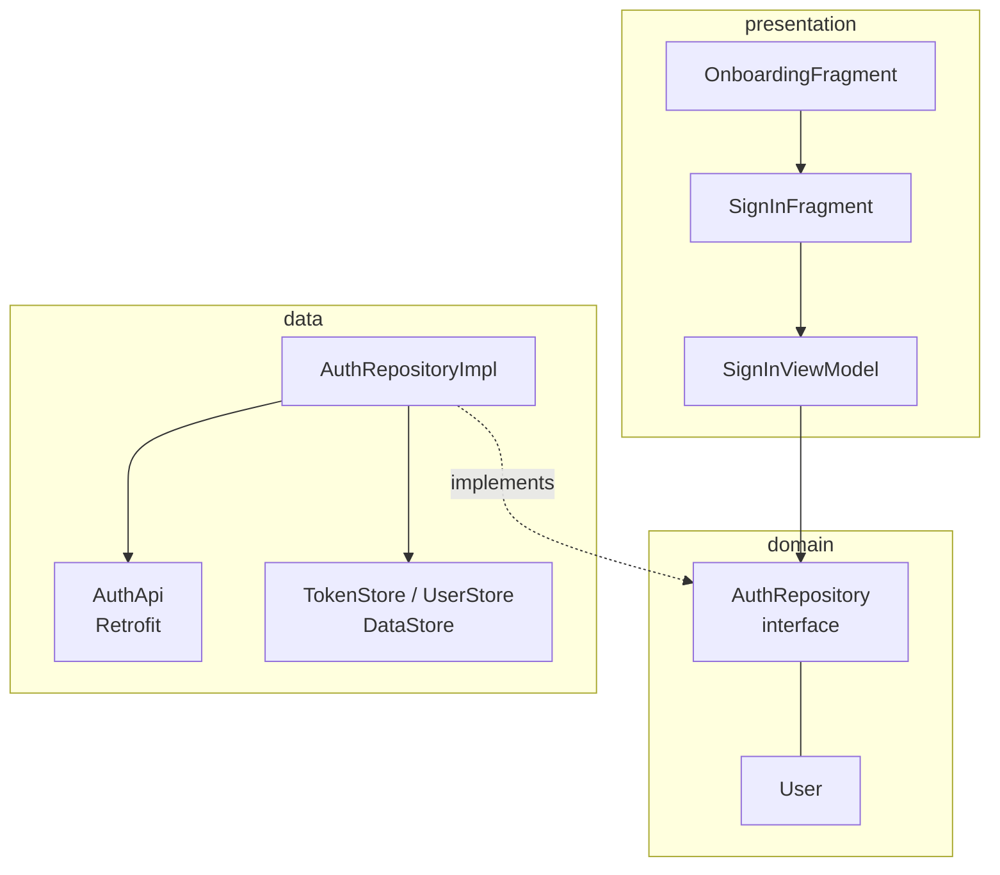

# Lokmart

  

Lokmart is the start of an online grocery store client, and the project where I practised **Clean Architecture** properly: a `domain` layer with interfaces, a `data` layer that implements them, and a `presentation` layer that only knows about ViewModels. Hilt glues it together, and the authentication flow is complete end to end — onboarding, sign-in, token storage.

## Features

- **Onboarding carousel** with a page indicator
- **Sign-in** against a REST API (`POST /auth/sign-in`)
- **Precise error handling** — wrong credentials (HTTP 404), no connection (`IOException`) and other failures each produce a different UI event
- **Session persistence** — the token and user are kept in **DataStore Preferences**
- **One-shot UI events** through `SingleLiveEvent`, so a toast doesn't fire again on rotation
- **Hilt modules** split by responsibility: Network, Api, Data, Repository

## How it works

### The sign-in flow
```kotlin
fun signIn(username: String, password: String) = viewModelScope.launch(Dispatchers.IO) {
    loading.postValue(true)
    try { authRepository.signIn(username, password) }
    catch (e: Exception) {
        when {
            e is HttpException && e.code() == 404 -> events.postValue(Event.InvalidCredentials)
            e is IOException -> events.postValue(Event.ConnectionError)
            else -> events.postValue(Event.Error)
        }
    } finally { loading.postValue(false) }
}
```
The ViewModel depends only on the `AuthRepository` **interface** from the domain layer; `AuthRepositoryImpl` (data layer) calls Retrofit and saves the token to `TokenStore`. Swapping the backend or faking it in tests touches nothing in the UI.

## Architecture



## Project structure

```
com.example.lokmart
├── app/
│   ├── App.kt
├── common/
│   ├── Constants.kt
├── data/
│   ├── api/auth/AuthApi.kt
│   ├── api/auth/dto/SignInRequest.kt
│   ├── api/auth/dto/SignInResponse.kt
│   ├── api/auth/dto/UserDto.kt
│   ├── repo/AuthRepositoryImpl.kt
│   ├── store/TokenStore.kt
│   ├── store/UserStore.kt
├── di/
│   ├── ApiModule.kt
│   ├── DataModule.kt
│   ├── NetworkModule.kt
│   ├── RepositoryModule.kt
├── domain/
│   ├── model/User.kt
│   ├── repo/AuthRepository.kt
├── presentation/
│   ├── main/MainActivity.kt
│   ├── onboarding/OnboardingAdapter.kt
│   ├── onboarding/OnboardingFragment.kt
│   ├── sign_in/SignInFragment.kt
│   ├── sign_in/SignInViewModel.kt
├── util/
│   ├── SingleLiveEvent.kt
```

<sub>21 source files · 435 lines of code · 4 layouts</sub>

## Tech stack

| | |
|---|---|
| **Language** | Kotlin |
| **UI** | XML layouts, View Binding |
| **Min / Target SDK** | 24 / 35 |
| **Hilt** | Dependency injection |
| **Retrofit** | HTTP client |
| **OkHttp** | HTTP / interceptors |
| **Glide** | Image loading |
| **Navigation component** | Screen navigation |
| **DataStore** | Key-value storage |
| **Gson** | JSON |

## Getting started

```bash
git clone https://github.com/rajabbov/Lokmart.git
```

1. Open the folder in **Android Studio** (Ladybug or newer).
2. Let Gradle sync.
3. Complete the configuration below, then run the `app` configuration.

### Configuration

Set your backend URL in `common/Constants.kt` (`HOST`). The project ships with it empty, so the sign-in screen will report a connection error until it points at a real API.

## Known limitations

- Only the authentication part of the store is implemented so far — catalog and cart are next.

---

Made by **Ibrohimjon Rajabboyev** · [@rajabbov](https://github.com/rajabbov)
